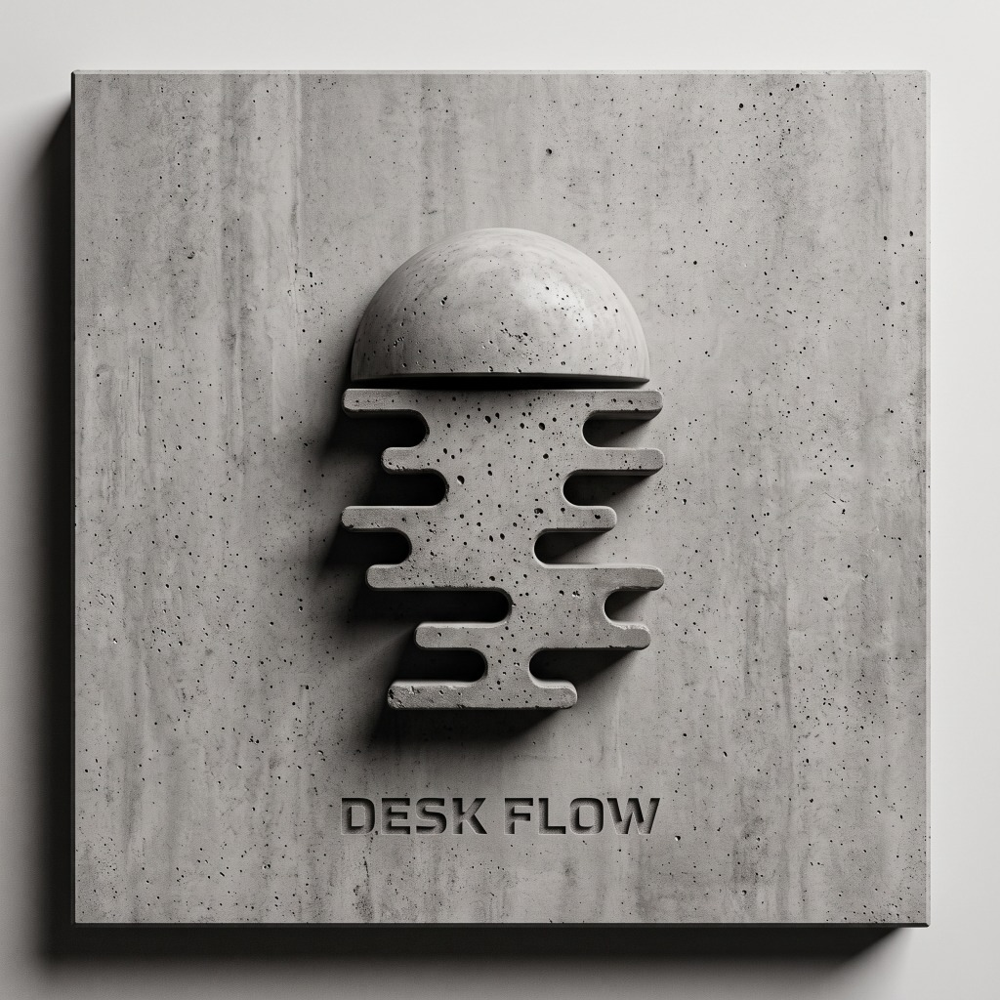

# DESKFLOW // BRUTALIST PC RECOVERY & WELLNESS SYSTEM

<p align="center">
  
</p>

<p align="center">
  <strong>High-impact, neurobiologically grounded PC ergonomics, sensory decompression, and wellness platform for intense computer work.</strong>
</p>

---

## ⚡ The Neo-Brutalist Philosophy
DeskFlow rejects corporate wellness clichés, pastel gradients, and bloated telemetry. Built with an uncompromising **Neo-Brutalist / Utilitarian** aesthetic:
- **Mechanical Tactile Borders & Stark Drop Shadows (`4px 4px 0px #000`)**
- **Physical Button Physics with Real Audio Feedback**
- **Zero Distraction UI** (Safety Yellow `#FFE600`, Acid Lime `#B8FF00`, Electric Cyan `#00E5FF`, Warning Pink `#FF3366`)
- **Stark Light / Dark Mode System**

---

## 🧠 Core Recovery & Decompression Protocols

### 1. `01. NEURO-BREATH`
- **The Physiological Sigh (Huberman Protocol):** The fastest biological method to dump alveolar carbon dioxide and down-regulate autonomic arousal in real-time. Features dual nasal inhale pacing (*70% -> 100% top-off*) followed by an extended 5.5-second mouth exhale with real-time frequency cues and round tally tracking.
- **Tactical Box Breathing (4-4-4-4):** Visual square pacer for heart rate variability balance used by tactical operators under high cognitive stress.

### 2. `02. SACCADIC EYES`
- **Bilateral Saccadic Movement (EMDR-inspired):** Computer screens force users into a narrow focal tunnel that triggers sympathetic hyper-vigilance. Follow the high-contrast target oscillating horizontally across the screen (*0.3 Hz Calm, 0.6 Hz Steady, 1.0 Hz Rapid*) to restore optical flow and calm amygdala overactivation.
- **20-20-20 Optic Preservation:** Automated 20-minute timer with seamless blackout rest integration.

### 3. `03. SOMATIC UNCLENCH`
- Targeted 20-second physical tension release protocols:
  - **Jaw Unclench & Tongue Drop:** Decompresses the temporomandibular joint (where 70% of keyboard clenching hides).
  - **Scapular Retraction:** Re-opens the chest cavity to counteract forward desk slouch.
  - **Palming Darkness Therapy:** Floods photoreceptor cones with absolute darkness.
  - **Median Nerve Glide:** Relieves carpal tunnel nerve entrapment.

### 4. `04. BINAURAL WAVES & AUDIO SHIELDING`
- **Pure Web Audio Stereo Entrainment:**
  - **Alpha Wave (10 Hz):** Relaxed alertness and flow state.
  - **Theta Wave (6 Hz):** Deep stress relief and intuition.
  - **Delta Wave (2.5 Hz):** Total somatic reset.
- **Heavy Brown Noise & Synthetic Rain:** Low-frequency acoustic shielding to mask office distractions.

### 5. `05. WORK // HYDRATE`
- **Brutalist Pomodoro:** Work (25m), Short Break (5m), and Long Break (15m) blocks with stark numerical displays.
- **Tactile Hydration Blocks:** 8 physical stamp blocks (250 mL each = 2,000 mL daily goal). Each stamp physically fills the block with electric cyan and logs progress.

### 6. `06. BRAIN DUMP`
- Monospace scratchpad with instant text utilities: *Strip Extra Spaces*, *UPPERCASE*, *lowercase*, and 1-click clipboard copy.

### 7. `BLACKOUT ZEN SCREEN`
- Global panic button that blacks out the display for 20 seconds of pure optic rest.

---

## 🚀 Running the App

### Option A: Desktop App (Electron)
Double-click `DeskFlow.bat` or run:
```bash
npm run app
```

### Option B: Local Web Server
```bash
npm install
npm run dev
```
Open [http://localhost:5174/](http://localhost:5174/) in your browser.

---

## 🛠️ Tech Stack
- **Framework:** Vanilla JS + Vite
- **Desktop Runtime:** Electron
- **Audio Engine:** Pure Web Audio API (procedural synthesis, no external audio files required)
- **Styling:** Custom Neo-Brutalist CSS tokens (`Space Grotesk` & `JetBrains Mono`)
